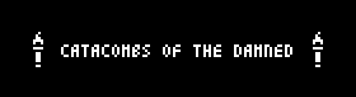
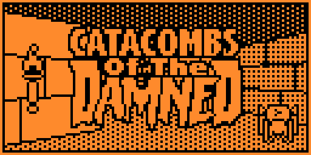
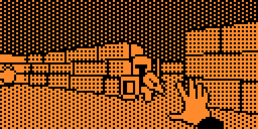
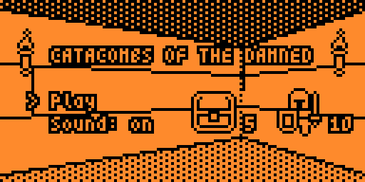
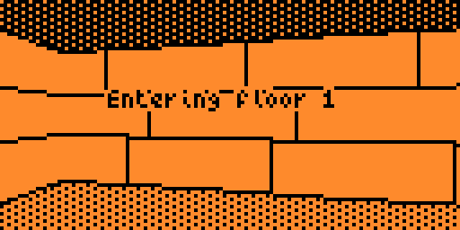
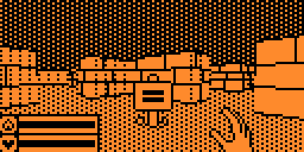
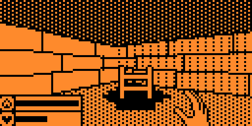
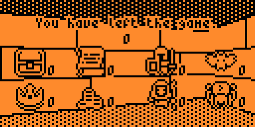
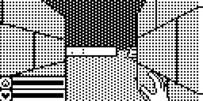

<p align="center">
  
</p>

A first-person dungeon crawler for the Flipper Zero, drawn in real time on its
128x64 one-bit screen. You descend ten floors of a procedurally generated
catacomb, burn skeletons, mages, bats and spiders with magical fireballs, pry
open chests and try to reach the last exit alive.

This is a port, not an original game. **Catacombs of the Damned!** was written
by **James Howard** for the [Arduboy](https://www.arduboy.com) as
[Arduboy3D](https://github.com/jhhoward/Arduboy3D), and is itself an homage to
the classic *Catacomb 3-D*. This repository carries that game over to the
Flipper Zero: the Arduino layer is gone and the engine now talks to the Flipper
API directly, rendering into the firmware's own canvas buffer, saving through
the SD card, and wrapped in a native menu with a title screen, a high score, and
sound and backlight toggles.

<p align="center">
  
  
  
</p>
<p align="center">
  
  
  
</p>
<p align="center">
  
</p>

## The dungeon

Every floor is generated from scratch when you enter it: a 32x24 grid of brick
is split recursively into rooms, doorways are knocked through the shared walls,
and any hall that comes out too open gets a block of masonry dropped in the
middle of it so the space still reads as a maze. Torches are scattered along the
walls for light, urns are wedged into corners as cover, and the entrance and the
exit are pinned to opposite ends of the map.

Then the floor is populated: up to 24 monsters, all placed out of line of sight
of where you start, and eight pieces of treasure, kept clear of both stairs.
Each piece is rolled independently between a healing potion, gold coins, a
chest, a crown and a scroll.

There are ten floors. Step onto the exit and the next one is built; step onto
the exit of the tenth and you have escaped the catacombs.

<p align="center">
  
</p>

## Gameplay

You carry 100 health and 100 mana. A fireball costs 20 mana and deals 10 damage,
and mana trickles back a point at a time whenever you are not reloading, so the
weapon is a rhythm rather than a trigger: five shots, then a pause. Health does
not come back on its own and it carries from floor to floor — mana refills at
every descent, hit points do not.

| Pickup | Effect |
|---|---|
| Potion | Restores 25 health, and is only consumed if you are actually hurt |
| Coins | 4 points |
| Scroll | 8 points |
| Crown | 10 points |
| Chest | Bursts open when you walk into it — 15 points |
| Urn | Solid decoration. It blocks you, and it blocks fireballs |
| Sign | *"Abandon all hope ye who enter!"* — on the first floor, by the entrance |

### Monsters

Four species share every floor, picked at random as each spawn point wakes up.
They hunt cell by cell, and the ranged one will only throw a fireball when it
has a clear line to you.

| Monster | Health | Speed | Damage | Notes |
|---|---|---|---|---|
| **Skeleton knight** | 50 | Slow | 20 | The wall of the dungeon. Staggers when hit, which is the only reason you can outrun one |
| **Mage** | 30 | Medium | 20 | Ranged. Fires back down any open corridor and staggers when hit |
| **Bat** | 20 | Fast | 10 | Flies at head height and never flinches |
| **Spider** | 10 | Fast | 5 | Dies to a single fireball, but comes in numbers and never flinches |

### Score

The run is scored when it ends, whether you died or escaped, and the best result
is kept on the SD card and shown in the menu:

- 20 points per floor cleared
- 500 for escaping the tenth floor
- 15 / 10 / 8 / 4 per chest, crown, scroll and coin pile
- 10 per skeleton or mage, 5 per bat, 4 per spider

The game over screen breaks the run down by loot and by kills, and tells you
what killed you and where.

## Controls

In the dungeon:

| Key | Action |
|---|---|
| Up / Down | walk forward / backward |
| Left / Right | turn |
| OK | cast a fireball |
| OK + Left / Right | strafe |
| Back long | back to the menu |

Walking into a chest opens it; walking over an item picks it up; walking onto
the exit takes you down a floor.

In the menu the arrows move and OK confirms. **Play** starts a run, **Sound**
and **Light** toggle the speaker and the backlight, **Score** and **High** show
your last and best runs, and **Credits** replays the title screen. A long press
of Back leaves the app.

## How it works

The engine never casts a ray per pixel. Walls are projected as segments and
filled with vector textures, with a one-byte-per-column w-buffer standing in for
a depth buffer; floors are drawn as lines between projected cell corners.
Sprites — monsters, torches, loot, particles — are transformed, culled against
the frustum, and queued with their inverse camera distance, so up to twelve of
them per frame sort back-to-front for free and are then blitted at whatever
scale their distance calls for, with an outline pass that keeps them readable
against a lit wall. All arithmetic is 16-bit fixed point with a 256-step circle,
and the sine and sprite-scale tables live in flash.

The port keeps that renderer intact and replaces everything under it. The game
draws into its own 1 KB framebuffer and the draw callback inverts it into the
firmware's canvas buffer in one pass; the framebuffer is fenced with guard bytes
on both sides, because an off-by-one write there used to land on the heap block
header and take the whole app down somewhere else entirely. Input arrives as
Flipper key events through a message queue and is folded into the same button
bitmask the Arduboy code expected. Sound goes to the speaker as note sequences,
and the save file — high score and the last run's breakdown — lives at
`/ext/apps_data/catacombs/eeprom.bin`, in place of the Arduboy's EEPROM.

## Building

The easiest way is [qUnleashed Desktop](https://github.com/DarkFlippers/qUnleashed)
and its Flibler tool (Tools > Flibler): point it at this repository, either the
Git URL or a local folder, pick the firmware channel, and it builds the `.fap`
on your computer when the SDK and toolchain are ready, or on the build server
otherwise, and can install it straight onto the connected Flipper.

The manual way is the firmware's build tool. Put the repository in
`applications_user/` of an Unleashed (or compatible) firmware tree and run:

```
./fbt fap_catacombs
```

## Credits

**Catacombs of the Damned!** and the Arduboy3D engine are the work of
**James Howard** — [jhhoward/Arduboy3D](https://github.com/jhhoward/Arduboy3D).
Its development history and the original discussion live in the Arduboy
community [forum thread](https://community.arduboy.com/t/another-fps-style-3d-demo/6565).

The Flipper Zero port is by ApertureFox Technology.

## Donation

| Service | Remark | QR Code | Link |
|---|---|---|---|
|  **Boosty** | Support the project | <div align="center"><a href="https://boosty.to/apfxtech/donate"></a></div> | [boosty.to/apfxtech/donate](https://boosty.to/apfxtech/donate) |
|  **YooMoney** | RU payments only | <div align="center"><a href="https://yoomoney.ru/fundraise/1IV33POM6H4.260711"></a></div> | [yoomoney.ru/fundraise/1IV33POM6H4.260711](https://yoomoney.ru/fundraise/1IV33POM6H4.260711) |

## Original Project
**James Howard**
[Arduboy3D](https://github.com/jhhoward/Arduboy3D)