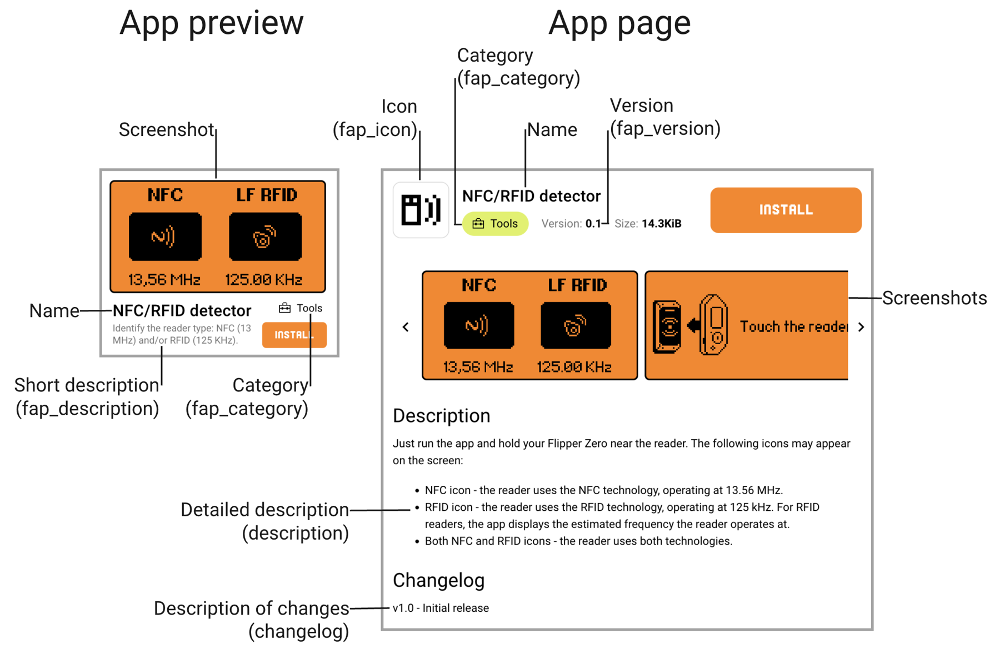

# qUnleashed Catalog: Contribution Guide

Thank you for your interest in contributing to the qUnleashed Catalog, a place where people can discover, download, and share community developed apps, menu styles and dolphin animations for Flipper Zero.

In this guide, you will learn how to use this repository to publish and update your entries in the catalog.

## General terms and requirements

 1. **Open Source License**. Entries submitted to this repository must be licensed under an Open Source License of your choice, permitting building and distribution in binary form by the qUnleashed catalog infrastructure.
 2. **No infringement on rights or trademarks**. Entries and data they produce or process must not infringe on any third-party rights or trademarks.
 3. **No malicious code**. Submitted entries must not contain any malicious code or code that may cause harm to the user's device or data.
 4. **No illegal activity**. Sharing links, instructions, or encouragement for illegal activities is prohibited.
 5. **Compliance with UGC Policies**. Entries must comply with the User-Generated Content Policies of [Play Store](https://support.google.com/googleplay/android-developer/answer/9876937) and [App Store](https://developer.apple.com/app-store/review/guidelines/#user-generated-content). We reserve the right to reject and remove entries that do not comply with these policies.
 6. **Metadata or source code updates**. If any changes to the metadata or source code are required, we will contact the author, as specified in the submitted pull request or using the contact information provided in the manifest file. If we do not receive a response within 14 days, the entry will be removed from the catalog.
 7. **Emergency updates**. If immediate changes are required to address a security vulnerability, copyright or any other critical issue, we reserve the right to unpublish the entry before contacting the author.
 8. **Reserved right to unpublish**. We reserve the right to reject and unpublish entries that do not comply with these terms and requirements, or for any other reason at any time.


## Publishing to the catalog

The repository doesn't host source code. It **only hosts** `manifest.yml` files with a link to the source code repository and the metadata.

> [!NOTE]
> The source code must be hosted in a public Git repository.

To publish:
1. Prepare the source code repository
2. Prepare metadata files and fill in the metadata fields
3. Create a pull request with the `manifest.yml` file in this repository
4. Wait until your pull request is approved and merged

Below, we discuss each step in more detail.

### Step 1. Preparing the source code repository

For an **app** or a **menu style**:

 1. Ensure your code is buildable with [uFBT](https://pypi.org/project/ufbt/) against the latest Release or Development SDK of Unleashed firmware.
 2. Add an app icon to the repository (10x10px 1-bit .png file). Menu styles may omit the icon.
 3. Add screenshots to the repository (take them using qFlipper and do not change their resolution or format). The first screenshot is shown in the preview.
 4. Create a Markdown-formatted file `README.md` with additional information. It is displayed as the detailed description in the catalog.
 5. Create a Markdown-formatted file `changelog.md`. In it, describe changes with each new version in the following format:

```
v0.2:
added images

v0.1:
added changelog
```

For a **dolphin animation**, the repository must contain the animation folder as the firmware expects it on the SD card: `meta.txt` and compiled `frame_*.bm` files. Several animations may live in one repository, each in its own folder. If you have no repository for it, the folder may be added to this repository next to its manifest instead, see [Animations](Manifest.md#animations-1).

### Step 2. Preparing metadata files

1. For an app or a menu style, create `application.fam` in your source code repository. Specify `appid` (must be unique), `name`, `fap_category`, `fap_version`, `fap_author` and so on. See [Flipper App Manifests (.fam)](https://developer.flipper.net/flipperzero/doxygen/app_manifests.html) for details. Apps use `apptype=FlipperAppType.EXTERNAL`, menu styles `apptype=FlipperAppType.PLUGIN`.
2. Write the author as `@name`, one or more: `fap_author="@alice @bob"`. Only `@name` authors become interactive in the qUnleashed app and can be followed; anything else is shown as plain text.
3. Commit the files to your repository.
4. Create `manifest.yml` (you later add it to this repository via pull request, see step 3). In the `commit_sha` field, specify the commit ID from the source repository. See [Manifest](./Manifest.md) for details, and the samples in [`example`](../example).

> [!NOTE]
> Please make sure your `manifest.yml` is valid as described [here](Manifest.md#validating-manifest).

Info from these fields is shown in the catalog after your entry is published:

<p align="center"></p>

### Step 3. Sending the pull request with manifest.yml

 1. Fork this repository and clone your fork to the local path.
 2. Create a new branch. The recommended naming scheme is `<username>/<appid>_<appversion>`.
 3. In the new branch, add your `manifest.yml` file to its directory:
    - app: `applications/<Category>[/<Subcategory>]/<appid>/`
    - menu style: `menustyles/<Category>/<appid>/`
    - animation: `animations/<Pack>[/<Collection>]/<Name>/`
 4. (Optional) Add a Markdown-formatted `README.md` file with additional information to the same directory as `manifest.yml`. When the user opens the manifest link of your entry, this readme is shown.
 5. Create a pull request from your branch, filling in the pull request template.

To learn more about contributing and forking on GitHub, see [Contributing to projects](https://docs.github.com/en/get-started/quickstart/contributing-to-projects).

### Step 4. Moderation

Once you submit your pull request, it will be moderated. Check your GitHub notifications to follow the review process. If you receive any error notifications, go to your PR page and find the review step that caused the issue for more details.

A few minutes after your pull request is merged, the entry is submitted to the catalog server. The server builds it for the current Release and Development SDK, and it appears in qUnleashed once a build succeeds.

## Updating

Updating is done in the same way as publishing. Each app and menu style submission must have a unique, higher version. Increment `fap_version` in `application.fam` in the source code repository. See [Manifest format description](./Manifest.md#version) for details.

An animation has no version: any change to its files is a new version.

## Entries that follow HEAD

A manifest may leave `commit_sha` out. It is accepted only for repositories the maintainers trust, such as [all-the-plugins](https://github.com/xMasterX/all-the-plugins) and repositories of friends of the project, and it is decided at review. Such entries are re-read once a day, and a new build is published when the version changes.
